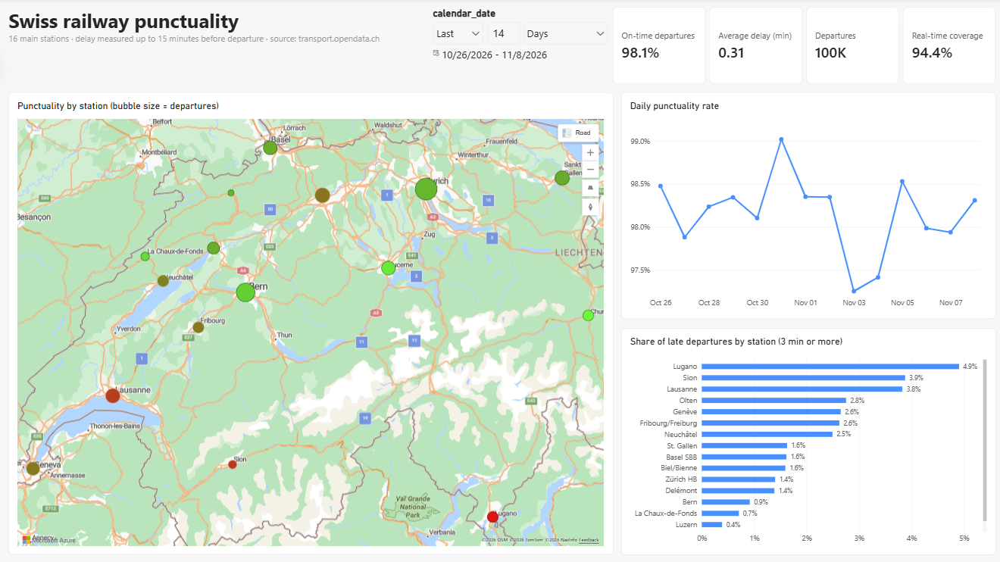
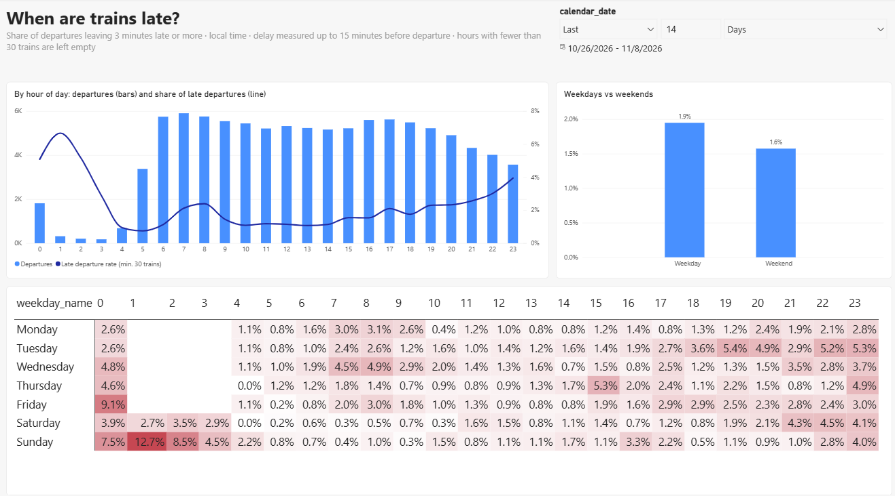
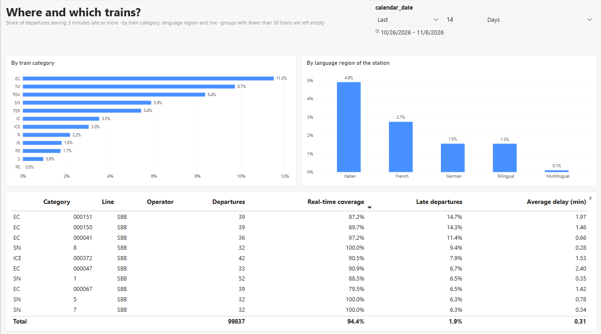
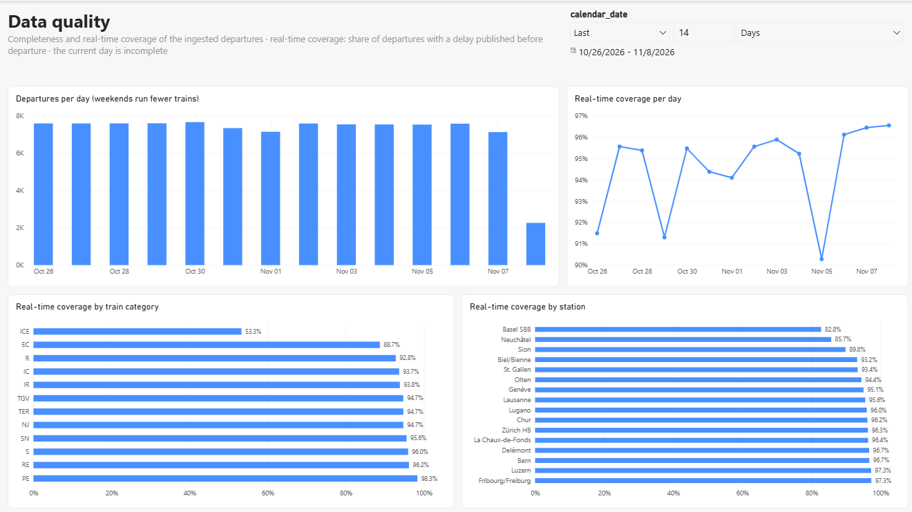
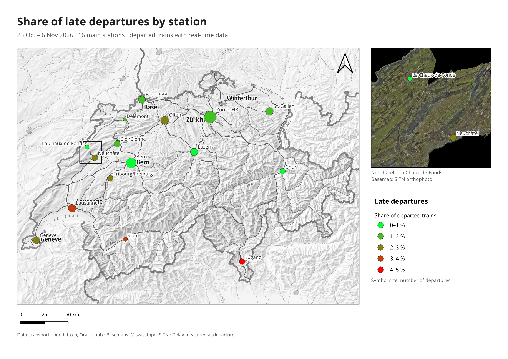

# Swiss Mobility Data Platform

Cloud data platform on Azure and **Microsoft Fabric** that measures the punctuality of Swiss trains from public open data, from the API to the report: every 15 minutes, departures are collected, then cleaned, modelled and tested, and published in a Power BI report and a QGIS map.

## At a glance

| | |
|---|---|
| Collection | every **15 minutes**, **16 main stations**, unattended in Azure |
| Volume | about **100,000 departures** every two weeks (7,600 per weekday) |
| Result | **98.1 %** of departures on time over 26 October – 8 November 2026, with **94.4 %** real-time coverage ([findings](#findings)) |



**What the project shows**

- **Ingestion**: Azure Function on a timer, REST API and Oracle reference data, retries and per-station error isolation, Parquet bronze in ADLS Gen2; secrets in Key Vault, managed identity.
- **Lakehouse and modelling**: OneLake shortcut, Fabric Lakehouse, dbt on a Fabric Warehouse (staging → intermediate → star schema), rules derived from profiling the raw data.
- **Quality**: dbt tests on keys, relationships and value ranges at every build, source freshness checks, 48 unit tests of the ingestion, a data quality page in the report.
- **Automation**: GitHub Actions for lint, tests and deployment, hourly `dbt build` followed by the refresh of the Direct Lake model; OIDC instead of stored secrets.
- **Operations**: alerts on failed runs and on silence at each stage, from the Azure Function to the Fabric notebook.
- **Reporting and GIS**: four-page Power BI report and a QGIS map built from the Warehouse with swisstopo and SITN geoservices.

## Architecture

```
 Oracle Autonomous DB            transport.opendata.ch (REST)
 stations, cantons                     departures
        │                                  │
        └──────────────┬───────────────────┘
                       │  Azure Function (timer, every 15 min)
                       │  secrets from Key Vault, managed identity
                       ▼
        ADLS Gen2 stswissmobility: bronze (Parquet, partitioned by ingestion day)
                       │  OneLake shortcut
                       ▼
 Fabric Lakehouse ──► dbt-fabric: staging → intermediate → marts (star schema)
                       │
                       ▼
               Power BI (Direct Lake)
               QGIS (GeoPackage export of the marts)
```

## Findings

Period 26 October – 8 November 2026, 16 main stations, about 100,000 scheduled departures. A departure is late when it leaves 3 minutes or more after the timetable; the delay is the last value published before departure (see [Known limitations](#known-limitations)).

- **Punctuality is high: 98.1 % of departures with real-time data leave on time**, with an average delay of 0.3 minutes. Real-time data covers 94.4 % of departures. The daily rate stays between 97.2 % and 99.0 %; the lowest days are 3 and 4 November.
- **Late departures are concentrated in a few stations.** Lugano (4.9 %), Sion (3.9 %) and Lausanne (3.8 %) have the highest shares; Luzern (0.4 %), La Chaux-de-Fonds (0.7 %) and Bern (0.9 %) the lowest. By language region: Italian 4.9 %, French 2.7 %, German 1.5 %. The Italian-speaking region is represented by Lugano alone.



- **Delays follow the daily load.** Around 1 % of departures are late at midday, about 2.5 % in the morning peak (7:00–8:00) and the share rises through the evening to about 4 % after 22:00, as delays accumulate over the day. Weekdays (1.9 %) are slightly worse than weekends (1.6 %). The high shares between midnight and 3:00 on weekends concern the night network and rest on few trains.



- **International trains are the least punctual.** EuroCity (11.5 % late), NightJet (9.7 %) and TGV (8.4 %) are far above the domestic categories: IC 3.5 %, IR 1.8 %, RE 1.7 %, S-Bahn 0.9 %. These trains start abroad and arrive in Switzerland with their delay; they also weigh on the stations they serve, such as Lugano (EuroCity to and from Milan), Genève and Lausanne (TGV).



- **The data is complete, the real-time coverage is not uniform.** About 7,600 departures are ingested per weekday, with no gap over the period; the lower days are weekends, which run fewer trains. The real-time coverage varies between 90 % and 97 % per day, with lows on 26 and 29 October and 5 November, when the punctuality rests on fewer trains. ICE departures have real-time data in only 53 % of cases, which also explains the lowest station coverage, Basel SBB (82.8 %). The report shows the coverage next to every punctuality figure for this reason.

These figures describe two weeks of data and the delay known before departure; they show where and when delays occur, not their causes.

## Repository layout

| Path | Content |
|---|---|
| `docker-compose.yml` | Local stack: Oracle Free + toolbox |
| `docker/toolbox/` | Dev image: Python 3.13, dbt-fabric, Azure CLI, ODBC Driver 18, sqlcmd, JupyterLab |
| `oracle/sql/` | DDL + reference data for the Oracle hub (26 cantons, 16 stations) |
| `oracle/init/` | Loads `oracle/sql/*.sql` on the first container start |
| `scripts/check_setup.py` | Smoke test of the local stack |
| `scripts/export_station_map.py` | Export of the station punctuality from the Warehouse to a GeoPackage (EPSG:2056) |
| `gis/` | QGIS project and the script that builds and exports its print layout |
| `docs/` | Exported map |
| `src/ingestion/` | Ingestion job: stations from Oracle → stationboard API → bronze Parquet |
| `src/function_app.py`, `src/host.json`, `src/requirements.txt` | Azure Function wrapper (deployment root: `src/`) |
| `notebooks/` | Exploration and design: API structure, retry policy, station loading, polling coverage (01-04), bronze profiling (05), reference data check against swissBOUNDARIES3D (06) |
| `fabric/workspace/` | Fabric workspace items synced by Fabric Git integration: Lakehouse and shortcut definitions, the bronze loading notebook, the Warehouse objects |
| `swiss-mobility-dbt/` | dbt project (staging / intermediate / marts + tests) |
| `tests/` | Unit tests of the ingestion (pytest), run in CI |
| `.github/workflows/ci.yml` | CI/CD: lint, tests and dbt parse on every push, deployment to Azure from `main` |
| `.github/workflows/dbt-build.yml` | hourly `dbt build` on the Fabric Warehouse, then refresh of the Power BI semantic model |

## Local setup (Windows)

**Prerequisites:** Docker Desktop (WSL 2 backend), Git, VS Code.

```powershell
cd C:\Users\soufi\Documents\Portfolio_data\Swiss_Mobility
copy .env.example .env          # then edit the passwords in .env
docker compose up -d --build    # first run: ~5-10 min (image build + Oracle init)
docker compose ps               # sm-oracle must show "healthy"
docker compose exec toolbox python scripts/check_setup.py
```

Expected result: 5 checks `[ OK ]`.

| Service | Address | Credentials |
|---|---|---|
| Oracle (from Windows, e.g. DBeaver / later the Fabric gateway) | `localhost:1521/FREEPDB1` | `ORACLE_APP_USER` / `ORACLE_APP_PASSWORD` from `.env` |
| Oracle (from the toolbox) | `oracle:1521/FREEPDB1` | same |
| JupyterLab | http://localhost:8888 | `JUPYTER_TOKEN` from `.env` |

### Everyday commands

```powershell
docker compose exec toolbox bash        # shell with dbt, az, sqlcmd, python
docker compose logs -f oracle           # watch Oracle start / init scripts
docker compose down                     # stop (data kept)
docker compose down -v                  # stop and wipe Oracle; reference data reloads on next start
```

### Running the ingestion

```powershell
docker compose exec toolbox python -m ingestion.run
```

Each run reads the station list from Oracle (cached in `data/state/` as a fallback), fetches the next departures of every station and appends two Parquet files, partitioned by ingestion day:

```
data/bronze/transport_stationboard/ingestion_date=YYYY-MM-DD/batch_<batch_id>.parquet   one row per departure
data/bronze/_ingestion_log/ingestion_date=YYYY-MM-DD/batch_<batch_id>.parquet           one row per station
```

| Situation | Behaviour |
|---|---|
| Timeout, connection error, HTTP 429/5xx | retried with exponential backoff (2 s, 4 s), max 3 attempts |
| Other HTTP error, departures of another station | station marked as failed, no retry |
| One station fails | other stations continue; failure recorded in the ingestion log |
| More than 50 % of stations fail | logs are written, then the run exits with code 1 |
| Oracle unavailable | cached station list used, warning logged; exit code 1 if no cache exists or it cannot be read |
| Station cache cannot be written | warning logged, departures still fetched |
| Bronze file cannot be written | error logged, exit code 1 |

### Reference data export

```powershell
docker compose exec toolbox python -m ingestion.reference
```

Exports a full snapshot of the hub tables `stations` and `cantons` to bronze, once a day in production:

```
bronze/oracle_stations/ingestion_date=YYYY-MM-DD/batch_<batch_id>.parquet
bronze/oracle_cantons/ingestion_date=YYYY-MM-DD/batch_<batch_id>.parquet
```

Both tables are read before anything is written, and a table with no row fails the run without writing: an empty snapshot would become the latest one and empty the station dimension. dbt staging keeps the latest snapshot (`max(_batch_id)`), so older snapshots remain as history.

### Station hub: local or cloud

The ingestion reads the station list from the Oracle hub selected by `ORACLE_TARGET` in `.env`:

| `ORACLE_TARGET` | Database | Connection |
|---|---|---|
| `local` (default) | Docker container `sm-oracle` | `ORACLE_DSN`, `ORACLE_APP_USER`, `ORACLE_APP_PASSWORD` |
| `cloud` | Oracle Autonomous AI Database (Always Free, eu-zurich-1) | `ORACLE_CLOUD_*` + mTLS wallet in `secrets/oracle_wallet/` (git-ignored) |

The cloud hub is created once with `oracle/cloud/load_hub_as_admin.sql` (run as ADMIN in Database Actions). The `mobility` user needs `CREATE SESSION`, `CREATE TABLE` and a quota on `DATA`.

After changing `.env`, recreate the toolbox so it picks up the new values: `docker compose up -d --force-recreate toolbox`.

### Storage: local or ADLS

`STORAGE_TARGET` in `.env` selects where bronze files and the station cache are written:

| `STORAGE_TARGET` | Location |
|---|---|
| `local` (default) | `data/bronze/…` and `data/state/stations_cache.json` |
| `adls` | storage account `ADLS_ACCOUNT_NAME`, containers `bronze` and `state` |

ADLS authentication uses `DefaultAzureCredential`, so the same code runs everywhere and only the environment selects the identity:

| Environment | Identity |
|---|---|
| Azure Function (production) | system-assigned managed identity, no secret |
| Toolbox (local tests) | service principal `sp-swissmobility-local`: `AZURE_TENANT_ID`, `AZURE_CLIENT_ID`, `AZURE_CLIENT_SECRET` in `.env` (secret valid 90 days) |

Each identity has the role **Storage Blob Data Contributor** on the storage account only. The containers `bronze` and `state` must exist; folders inside them are created on write.

Bronze files are append-only: a file is created only if it does not exist yet (condition checked by the service), then its content is appended and committed. If the upload fails, the incomplete file is deleted, so the dataset never contains an empty Parquet file.

Test run against ADLS without changing `.env`:

```powershell
docker compose exec -e STORAGE_TARGET=adls toolbox python -m ingestion.run
```

### Production: Azure Function

The ingestion runs in the Function App `func-swissmobility-sb` (Flex Consumption, Python 3.13, 512 MB), triggered every 15 minutes (`0 */15 * * * *`, UTC). The PC is not involved.

| Resource | Purpose |
|---|---|
| `func-swissmobility-sb` | `ingest_stationboard` runs `ingestion.run.main()` every 15 minutes; `export_reference` runs `ingestion.reference.main()` daily at 04:05 UTC. A non-zero exit code fails the invocation |
| `kv-swissmobility-sb` (Key Vault) | `oracle-cloud-password`, `oracle-wallet-password`, `oracle-wallet-pem-b64` |
| `stswissmobility` (ADLS Gen2) | containers `bronze` and `state` |
| Application Insights | run logs and invocation history |

The Function authenticates with its system-assigned managed identity, which has **Storage Blob Data Contributor** on `stswissmobility` and **Key Vault Secrets User** on the vault. No secret is stored in the app settings:

| App setting | Value |
|---|---|
| `ORACLE_TARGET` / `STORAGE_TARGET` | `cloud` / `adls` |
| `ADLS_ACCOUNT_NAME` | `stswissmobility` |
| `ORACLE_CLOUD_USER` | `mobility` |
| `ORACLE_CLOUD_DSN` | full connect descriptor (no `tnsnames.ora` in the Function) |
| `ORACLE_CLOUD_PASSWORD`, `ORACLE_WALLET_PASSWORD`, `ORACLE_WALLET_PEM_B64` | `@Microsoft.KeyVault(VaultName=kv-swissmobility-sb;SecretName=…)` |

At startup, `function_app.py` decodes the wallet (`ewallet.pem`, base64 in Key Vault) into a temporary folder and sets `ORACLE_WALLET_DIR`. `AZURE_CLIENT_ID` / `AZURE_CLIENT_SECRET` must not be set on the Function, otherwise `DefaultAzureCredential` would use the local service principal instead of the managed identity.

Deployment: automatic from GitHub Actions, see [CI/CD](#cicd).

### Monitoring and alerting

Every stage of the pipeline is watched twice: once for **failures** (a job reports an error) and once for **silence** (nothing new arrives, whatever the cause).

```
Function (15 min) ──► ADLS bronze ──► notebook (hourly) ──► Lakehouse ──► dbt build (hourly) ──► marts ──► report
   │                                     │                                  │
   ├─ run failed       (Azure alert)     ├─ job failed (Activator)          ├─ build or test failed (GitHub)
   └─ no success 45 min (Azure alert)    │                                  └─ bronze older than 24 h (dbt freshness)
                                         └──────── also covered by dbt freshness ─────────┘
```

| Component | What can go wrong | Detected by | Notification | Delay |
|---|---|---|---|---|
| Azure Function `ingest_stationboard` / `export_reference` | run ends with an error (more than 50 % of stations failed, storage not writable, no station list, Oracle export failed) | Azure Monitor rule `alert-ingestion-run-failed` | email (action group `ag-swissmobility-oncall`) | about 15 min |
| Azure Function `ingest_stationboard` | no run at all: Function stopped or disabled, code not loading, timer not firing | Azure Monitor rule `alert-ingestion-heartbeat` (no success in 45 min) | email | 45 to 60 min |
| Single station | API error for one station | ingestion log (`status = failed`) | none: reviewed in the data | — |
| Fabric notebook `nb_load_bronze` | run fails | Activator `act_monitoring`, rule on `ItemJobFailed` job events | email | minutes |
| dbt (`dbt-build.yml`) | a model fails to build or a test fails | GitHub Actions run fails | GitHub email | at the next hourly run |
| Whole chain up to the Lakehouse | data stops arriving for any reason: Function, ADLS, shortcut, notebook or schedule | `dbt source freshness` after each build (departures: error after 24 h; Oracle snapshot: 72 h) | GitHub email | up to 24 h |
| Platform | Azure incident in the region (e.g. delayed log ingestion) | Azure Service Health | — | — |

The freshness check is the safety net: it looks at the end of the chain, so it catches failures that produce no error at all.

#### Azure alert rules

Every invocation of the Function is recorded in Application Insights (table `requests`, one row per run). Two log search alert rules query it and notify the action group `ag-swissmobility-oncall` (email):

| Rule | Query | Condition | Detects |
|---|---|---|---|
| `alert-ingestion-run-failed` | `requests` where `name in ("ingest_stationboard", "export_reference")` and `success == false` | more than 0 rows in 15 min, evaluated every 15 min | a run ended with an error |
| `alert-ingestion-heartbeat` | `requests` where `name == "ingest_stationboard"` and `success == true` | fewer than 1 row in 45 min, evaluated every 15 min | no successful run for three cycles |

Both rules have severity 1 and resolve automatically once a run succeeds. The heartbeat window tolerates two missed runs before alerting, to avoid false alarms on a single late start. The daily reference export is covered by the failure rule and by the 72-hour freshness check, not by the heartbeat.

Run history over the last hours:

```kusto
requests
| where timestamp > ago(3h)
| where name == "ingest_stationboard"
| project timestamp, success, duration, resultCode
| order by timestamp desc
```

#### Tests of the alerts

| Alert | Test | Result |
|---|---|---|
| `alert-ingestion-run-failed` | one run with an invalid `ORACLE_TARGET` | fired 6 minutes later, resolved after the next successful run |
| `alert-ingestion-heartbeat` | Function disabled for an hour | fired, email delivered |
| Activator `act_monitoring` | notebook run with a dataset folder that does not exist | email delivered |
| real incident | the API was unreachable for a few minutes at night (24 and 25 October): 12 of 16 stations failed | `alert-ingestion-run-failed` fired |

The email address of an action group must be verified before notifications are delivered.

### CI/CD

`.github/workflows/ci.yml` runs on GitHub Actions:

```
push (any branch) / pull request to main
   └── test:   ruff check src tests  →  pytest (40 tests, no network, no secret)
                  │ green, and push to main only
                  ▼
           deploy: azure/login (OIDC)  →  Azure/functions-action, package src/, remote build
```

| Job | Runs on | Purpose |
|---|---|---|
| `test` | every push and pull request | lint, then the unit tests against the Function's own dependencies (`tests/requirements.txt` includes `src/requirements.txt`) |
| `deploy` | push to `main`, only if `test` passed | replaces the code of `func-swissmobility-sb`; one deployment at a time |

The deploy job authenticates with **workload identity federation**: no secret is stored. The app registration `sp-swissmobility-github` trusts GitHub tokens for `repo:sami-beniaouf/swiss-mobility-data-platform`, branch `main` only, and has the role **Website Contributor** on the Function App only. The repository secrets `AZURE_CLIENT_ID`, `AZURE_TENANT_ID` and `AZURE_SUBSCRIPTION_ID` hold identifiers, not credentials; they are stored as secrets to keep them out of public logs.

A push deploys the code in `src/` (including `host.json` and `requirements.txt`). App settings, Key Vault secrets, role assignments and alert rules are not part of the deployment: a new setting is added to the Function App before the code that uses it is pushed.

Tests locally:

```powershell
docker compose exec toolbox ruff check src tests
docker compose exec toolbox python -m pytest
```

### Fabric: Lakehouse and Warehouse

Workspace `ws-swiss-mobility` (Fabric trial capacity):

| Item | Role |
|---|---|
| `lh_mobility` (Lakehouse) | bronze as Delta tables: `transport_stationboard`, `ingestion_log`, `oracle_stations`, `oracle_cantons` |
| shortcut `Files/bronze` | link to the ADLS container `bronze` (no copy); connection as an organizational account with **Storage Blob Data Reader** on the container only |
| `nb_load_bronze` (notebook, hourly) | reads the Parquet through the shortcut and rewrites the Delta tables (full reload, `mergeSchema` for older files) |
| `wh_mobility` (Warehouse) | silver and gold, built by dbt; reads the Lakehouse tables with cross-database queries (`lh_mobility.dbo.…`) |

Bronze files are plain Parquet, so they are loaded by the notebook rather than exposed directly as tables (a table shortcut requires Delta, and shortcut file transformations were not available in the tenant).

The workspace is connected to this repository with **Fabric Git integration** (branch `main`, folder `fabric/workspace`): every item is versioned as text (`notebook-content.py`, `shortcuts.metadata.json`, the Warehouse as an SQL project). Changes made in Fabric are committed from the workspace's Source control panel. The Warehouse objects are created by dbt, which remains their source of truth: their Git copy is a snapshot, and "Update from Git" is not used for them. The GitHub connection uses a fine-grained token limited to this repository (Contents read and write, 90 days).

### Transformation with dbt

```
lh_mobility (bronze)            wh_mobility
  transport_stationboard ──►  staging       stg_transport__departures      view
  oracle_stations        ──►                stg_oracle__stations           view
  oracle_cantons         ──►                stg_oracle__cantons            view
                              intermediate  int_departures__enriched       view
                              marts         dim_date, dim_station,         tables
                                            dim_line, fct_departures
                              reference     transport_categories (seed)    table
```

| Layer | Models | Rules |
|---|---|---|
| staging (silver) | one model per source table: types, trimming, deduplication | departures: one row per `station + category + line + scheduled time + destination`, latest poll kept; within a poll, the copy with a known delay wins. Reference tables: latest daily snapshot (`max(_batch_id)`) |
| intermediate (silver) | `int_departures__enriched` | only departures that have taken place (planned time + last known delay before the latest poll); transport mode from the seed; local date and hour; `is_punctual` = delay < `punctuality_threshold_min` (3 min), null when no real-time data |
| marts (gold) | star schema | `fct_departures` (grain: one scheduled departure at one station) with `dim_station` (stations with canton and language region), `dim_line` (category + line + operator), `dim_date` (calendar) |

Punctuality KPI: `SUM(is_punctual) / SUM(has_realtime)`, reported with the real-time coverage (`SUM(has_realtime) / COUNT(*)`).

Tests (`dbt test`, 30): `unique` and `not_null` on every key, `relationships` between facts, dimensions, sources and the seed, `accepted_values` on flags and language regions, and the singular test `assert_delay_within_bounds` (0 to 300 minutes, bounds taken from the profiling).

**Connection.** dbt connects from the toolbox as the service principal `sp-swissmobility-dbt` (Contributor on the workspace; tenant setting "Service principals can use Fabric APIs" enabled). `profiles.yml` (git-ignored, copied from `profiles_example.yml`) uses `authentication: token_credential` with `azure.identity.ClientSecretCredential`: the token is acquired by azure-identity and passed to the driver. `ActiveDirectoryServicePrincipal` is not used because dbt-fabric 1.11 sends an `Authority Id` keyword its driver rejects. Credentials come from `.env` (`AZURE_TENANT_ID`, `DBT_CLIENT_ID`, `DBT_CLIENT_SECRET`).

```powershell
docker compose exec -w /workspace/swiss-mobility-dbt toolbox dbt debug    # configuration and connection
docker compose exec -w /workspace/swiss-mobility-dbt toolbox dbt seed     # transport_categories
docker compose exec -w /workspace/swiss-mobility-dbt toolbox dbt run      # all models, in dependency order
docker compose exec -w /workspace/swiss-mobility-dbt toolbox dbt test     # 30 tests
```

`dbt run --select staging` builds one layer only. The CI parses the project on every push (`dbt parse`, no connection).

**Production runs.** `.github/workflows/dbt-build.yml` runs `dbt build --target prod` (seed, models and tests in dependency order) every hour at minute 20 UTC, after the bronze notebook, and on demand from the Actions tab. It signs in as the same identity `sp-swissmobility-dbt`, but with workload identity federation instead of a secret: a federated credential trusts GitHub tokens for this repository and branch `main` only (subject `repo:sami-beniaouf@<owner id>/swiss-mobility-data-platform@<repo id>:ref:refs/heads/main`), and dbt reuses the Azure CLI session (`authentication: CLI`, profile `ci/profiles.yml`). The Warehouse address comes from the repository secret `FABRIC_SQL_SERVER`. After a successful build, the workflow refreshes the Direct Lake semantic model `sm_mobility` through the Power BI REST API with the same identity: dbt recreates the gold tables, and the model keeps reading the previous Parquet files until it is reframed (automatic Direct Lake updates do not follow dropped and recreated tables). Since the Warehouse publishes the Delta log of a new table to OneLake asynchronously, the refresh starts after 60 seconds and is retried up to 3 times. The workspace and model IDs come from the repository variables `FABRIC_WORKSPACE_ID` and `SEMANTIC_MODEL_ID`. `run_results.json` and `dbt.log` are kept as run artifacts for 14 days; a failed scheduled run is reported by GitHub by email.

| Identity | Used by | Authentication |
|---|---|---|
| `sp-swissmobility-dbt` | dbt from the toolbox | client secret in `.env` |
| `sp-swissmobility-dbt` | scheduled dbt build | OIDC, no secret |

### Map in QGIS



The map reads the gold layer of the Warehouse, not a copy of the report data, so it shows the same figures as the Power BI report.

1. `scripts/export_station_map.py` queries `dim_station` and `fct_departures` over the last 14 days (`--days`) as `sp-swissmobility-dbt` and writes one point per station to `data/gis/station_punctuality.gpkg` (Swiss LV95, EPSG:2056): departures, share of late departures, punctuality, real-time coverage, average delay, canton and language region. The rates use the same rules as the semantic model (departed trains with real-time data, 3-minute threshold).
2. `gis/station_punctuality.qgz` styles the layer: colour by share of late departures (1-point classes), size by number of departures, labels with the station name. It references the GeoPackage by relative path.
3. `gis/build_print_layout.py`, run from the QGIS Python console, builds the A4 layout and exports `docs/station_punctuality_map.png` at 200 dpi.

```powershell
docker compose exec toolbox python scripts/export_station_map.py --days 14
```

```python
# QGIS Python console, with gis/station_punctuality.qgz open
exec(open("gis/build_print_layout.py", encoding="utf-8").read())
```

| Layer | Service | Use |
|---|---|---|
| Landeskarten (grau) | swisstopo WMTS | screen |
| swisstopo national map grey | swisstopo WMS (`wms.geo.admin.ch`) | print: the WMS renders the map scale that fits the export resolution, where the WMTS would switch to a more detailed map at 200 dpi |
| SITN orthophoto 2016 | SITN WMS (`sitn.ne.ch/ogc-sitn-open/wms`), canton of Neuchâtel | inset Neuchâtel – La Chaux-de-Fonds |

## Data sources

- **transport.opendata.ch**: departures (stationboard). Note: in `/v1/locations`, `coordinate.x` is the latitude and `coordinate.y` the longitude.
- **Oracle hub (simulated)**: stations (BPUIC id, BFS municipality number, LV95 coordinates) and cantons (language region).

### Known limitations

Established by profiling the bronze data (`notebooks/05_bronze_profiling.ipynb`):

| Limitation | Effect | Handling |
|---|---|---|
| The stationboard API has no cancellation information | cancelled departures cannot be identified | punctuality covers departures that ran with real-time data |
| Real-time coverage varies by category (S, IR, IC, RE, R: 85-94 %; ICE 45 %; night S-Bahn 32 %) | punctuality of low-coverage categories rests on few departures | reports show the coverage (`has_realtime`) next to the punctuality rate |
| A few cross-border departures have two train numbers (e.g. IR 36 / ICE 109 from Basel, 0.07 % of departures) | counted as two departures | accepted |
| The delay of a departure is the last value seen before it leaves, at most 15 minutes earlier (polling interval) | a delay that grows in the last minutes is not captured | accepted; punctuality is measured on the last known delay |
| The API is unreachable for a few minutes most nights | the stations polled during the outage have no departures in that batch; departures are still captured by the following polls | failed station calls are recorded in the ingestion log; the run fails and alerts above 50 % |
